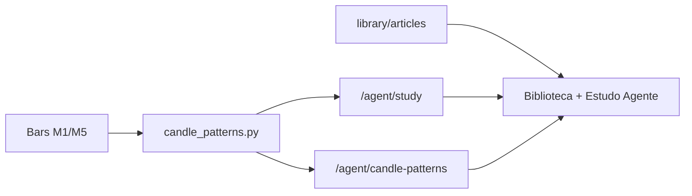

# Conhecimento do agente — arquitetura em duas camadas

Inspirado em pipelines híbridos (sinais numéricos + texto curado), o Sala de Sinais separa **detecção matemática** de **explicação pedagógica**.

## Camada 1 — Código (Python)

| Componente | Caminho | Função |
|------------|---------|--------|
| Detecção | `shared/candle_patterns.py` | OHLC → padrões clássicos (martelo, doji, engolfo, etc.) |
| Serviço API | `api/candle_patterns.py` | Resample M1→M5 via `get_ohlc`, janela configurável |
| Estudo ao vivo | `api/agent_study.py` | `candle_patterns` e `trade_playbook` no `GET /agent/study` |
| Playbooks DT | `shared/daytrade_rules.py` | Pilares + níveis exemplo a partir da config/engine |

**Endpoints**

- `GET /agent/candle-patterns?symbol=PETR4&tf=M5&limit=80&lookback=24`
- `GET /agent/study?symbol=…` (inclui a mesma análise em `candle_patterns`)

**Motor de detecção**

1. **Padrão:** implementação pure Python (sem dependência nativa).
2. **Opcional:** se `TA-Lib` estiver instalado, o módulo usa funções `CDL*` e mantém fallback Python quando não há match.

### TA-Lib no Windows

A wheel Python exige a biblioteca C:

1. Baixe/build TA-Lib C para Windows ou use wheel não oficial compatível com sua versão de Python.
2. Ative o venv do projeto.
3. `pip install TA-Lib`
4. Descomente `# TA-Lib>=0.4.28` em `requirements.txt` se quiser fixar versão no deploy.

Sem TA-Lib, o sistema continua operacional com `engine: "pure_python"`.

## Camada 2 — Biblioteca (RAG manual)

| Componente | Caminho | Função |
|------------|---------|--------|
| Artigos | `library/articles/*.md` | Regras, psicologia, contexto B3/day trade |
| Catálogo | `library/index.json` | IDs, categorias (`candles`), tags |
| Nível do agente | `api/library_knowledge.py` | Progresso por artigos **lidos** (cockpit) ou tamanho da base (API sem `read_ids`) |

**Visão do produto:** a biblioteca foi concebida também como memória para o **agente** aplicar na operação (não só leitura humana). Hoje ela alimenta pedagogia, links no estudo e nível na UI — **não** o sinal automático. Lacunas e roteiro (RAG, portão LLM, feedback): [VISAO_APRENDIZAGEM_AGENTE.md](./VISAO_APRENDIZAGEM_AGENTE.md).

## Camada 3 — Aprendizado com trades (estatística)

| Componente | Caminho | Função |
|------------|---------|--------|
| Agregados | `shared/trade_learning.py` | Win rate, expectativa, faixa horária, insights PT |
| API | `api/trade_learning.py` | `/agent/learning-stats`, `/library/learning-insights` |
| Feedback motor | `engine/trade_feedback.py` | Cooldown, filtro conservador, qty (auto) |
| Persistência | `data/trade_learning.json` | Últimos insights + snapshot compacto |

Ver [TRADE_LEARNING.md](./TRADE_LEARNING.md). **Não substitui** a biblioteca: trades informam *o que funcionou na sua conta*; artigos explicam *como operar*.

### Onde ver estratégia aplicada vs. melhor resultado

- **Por trade:** aba **Lucros** → **Operações recentes** (coluna **Estratégia**: `breakout` / `volatilidade`) ou `GET /metrics/trades?symbol=PETR4&limit=200` (`strategy_type`, `entry_reason`).
- **Melhor estratégia (global, todas as ações):** aba **Agente** ou **Sistema** → card **Aprendizado com trades** (linhas **Melhor** / **Pior**) ou `GET /agent/learning-stats` → `best_strategy` / `by_strategy`.
- **Só o ativo que você opera:** aba **Painel** (KPI deck) ou **Agente** / **Sistema** → card **«SYMBOL: breakout vs volatilidade»** (dados de `GET /metrics/trades?symbol=…`, agrupados por `strategy_type` no cockpit); alternativa: `performance_learning.rolling_combos` filtrado por `symbol` em `GET /library/learning-insights`.

## Fluxo no cockpit

Na aba **Painel**, o card **Raio-X do agente** consolida três leituras (poll lento ~30s, junto com o insight deck):

| Bloco | Fonte | O que mostra |
|-------|--------|----------------|
| Conhecimento day trade | `GET /library/knowledge-level?read_ids=…` | Nível (Iniciante→Avançado), barra até próxima faixa, artigos/palavras **lidos** |
| Acertos e erros | `GET /agent/learning-stats` → `performance_learning.rolling` (últimos 20 fechados); fallback WR do dia em `/metrics/pnl` | WR %, taxa de erro, W/L e PnL da janela |
| Se fosse dinheiro real | `capital_brl` e `risk_per_trade_pct` do agente + `/metrics/pnl` | Patrimônio est. = capital + PnL fechado acumulado + MTM aberto; risco R$/trade; perda do dia vs capital |

O chip **Demo / Sim / LIVE** vem de `GET /system/execution-status` (não confundir métricas do painel com extrato MT5). Texto de rodapé: simulação educativa, não recomendação.

## Estratégias Day Trade (regras)

| Camada | O quê | Onde |
|--------|-------|------|
| Playbooks | Três pilares (contexto / gatilho / saída) mapeados a `breakout` e `volatility` | `shared/daytrade_rules.py` |
| Números ao vivo | Entrada, stop, alvo, R:R alinhados ao engine | `trade_playbook` em `GET /agent/study` |
| Pedagogia | Artigos 14–18 (pilares, range, ATR, R:R, leilão 17h55) | `library/articles/` |

O agente **não inventa** stops: lê `stop_loss_pct`, `take_profit_pct`, `stop_points`, `target_points` e `strategy_type` da config do usuário e replica a mesma lógica das classes em `engine/strategy*.py`. A biblioteca linka `library_article_ids` no playbook para explicar *por que* operar assim na B3.

Candles (`candle_patterns`) continuam independentes — úteis como contexto visual; o gatilho automático do engine permanece rompimento de range.

## Roadmap (sem compromisso nesta entrega)

| Item | Descrição |
|------|-----------|
| Backtest | `backtesting.py` ou QuantConnect LEAN sobre os mesmos playbooks — **sem integração** hoje |
| Backfill OHLC | `yfinance` ou feed B3 para enriquecer barras históricas |
| RAG automático | Embeddings sobre biblioteca + snippets de datasets HF educacionais |
| HF datasets | Citados em `08-fontes-abertas` — importação em lote **não** feita por padrão (tamanho/licença) |

## Testes

- `tests/test_candle_patterns.py` — barras sintéticas (martelo, doji, engolfo).
- `tests/test_daytrade_rules.py` — playbooks, R:R e seção `trade_playbook`.
- `tests/test_trade_learning.py` — agregados, faixas horárias, endpoints learning.
- `pytest` no venv: `.venv\Scripts\python.exe -m pytest tests/test_daytrade_rules.py tests/test_agent_study.py`

## Referências internas

- [BIBLIOTECA.md](./BIBLIOTECA.md) — API e níveis de conhecimento
- [AGENTE_CONHECIMENTO.md](./AGENTE_CONHECIMENTO.md) — visão geral notícias + biblioteca
