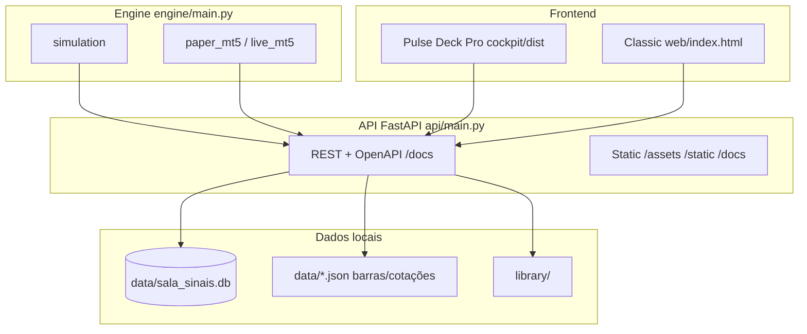

# GEMINI_CONTEXTO_SISTEMA — Sala de Sinais / Pulse Deck Pro

> **Propósito deste arquivo:** contexto único, verificado contra o código em outubro/2026, para colar no Gemini (ou outro LLM) e co-desenhar melhorias.  
> **Repositório:** `c:\Users\xgame\sala-sinais`  
> **Versão da API (FastAPI):** `0.2.0` (`api/main.py`)  
> **Produto na UI:** **Pulse Deck Pro** (`cockpit/`, servido em `/` quando `cockpit/dist/index.html` existe).

---

## 1. Visão e objetivo do produto

**Sala de Sinais** é infraestrutura **educacional** de day trade na B3 (mini-índice WIN/WDO e **ações** via presets), não consultoria nem garantia de lucro.

| Objetivo | Como o sistema entrega |
|----------|-------------------------|
| Treinar antes de risco real | Modo `simulation` (sem MT5), sinais + PnL + painel |
| Conectar cotação/execução reais | `paper_mt5` / `live_mt5` + MetaTrader 5 da corretora |
| Transparência | Sinais em SQLite, motivos `entry_reason` / `exit_reason`, métricas com taxas estimadas |
| Pedagogia | Biblioteca Markdown + **agente de estudo** (estratégia, candles, SMC, playbooks DT) |
| Operação | Engine Python gera sinais; API FastAPI persiste e serve UI; cockpit consome REST com polling |

**Fluxo mental:** Engine → `POST /signals` (webhook) → SQLite → Painel (Pulse Deck ou `/classic`) + endpoints de mercado/agente.

---

## 2. Arquitetura em camadas



### 2.1 Pastas principais

| Pasta | Função | Arquivos-chave |
|-------|--------|----------------|
| `api/` | FastAPI, SQLite, serviços de mercado/PnL/biblioteca | `main.py`, `database.py`, `pnl.py`, `agent_study.py`, … |
| `engine/` | Loop de mercado, estratégias, MT5, simulador | `main.py`, `strategy.py`, `strategy_volatility.py`, `execution.py`, `api_client.py` |
| `shared/` | Contratos Pydantic, regras DT, candles, SMC, política de execução | `schemas.py`, `daytrade_rules.py`, `candle_patterns.py`, `structure_analysis.py`, `execution_policy.py`, `ohlc_utils.py` |
| `cockpit/` | Pulse Deck Pro (Vite + TypeScript + lightweight-charts) | `src/main.ts`, `src/api/client.ts`, `src/pulse/*` |
| `web/` | Painel legado **classic** (Chart.js, ~2700 linhas em `app.js`) | `index.html`, `app.js` |
| `library/` | Base curada RAG manual | `index.json`, `articles/*.md` |
| `data/` | SQLite + JSON runtime | `sala_sinais.db`, `last_quote.json`, `quote_history.json`, `bars_{SYMBOL}.json`, `b3_tickers_popular.json` |
| `docs/` | Documentação humana | Este arquivo + `AGENT_KNOWLEDGE.md`, `COCKPIT.md`, `ROADMAP.md`, … |
| `tests/` | pytest | 15+ módulos (PnL, agent, SMC, library, IDs UI) |

**Nota:** Não há routers FastAPI separados por arquivo — **todos os endpoints HTTP estão declarados em** `api/main.py`. Os outros `.py` em `api/` são **módulos de serviço** importados por `main.py`.

### 2.2 Módulos Python em `api/` (serviços, não routers)

| Módulo | Responsabilidade |
|--------|------------------|
| `agent_study.py` | Monta `GET /agent/study` (estratégia, sessão B3, histórico, playbook, candles, SMC resumido) |
| `agent_config.py` | Presets moderado/conservador/agressivo, patch config, defaults B3 |
| `b3_tickers.py` | Busca em `data/b3_tickers_popular.json` |
| `candle_patterns.py` | Wrapper OHLC → `shared/candle_patterns` |
| `config.py` | Settings API (host, DB, taxas, CORS, cache news) |
| `database.py` | SQLAlchemy models + migrations leves |
| `equity_curve.py` | Curva de patrimônio diária |
| `execution_status.py` | Checklist execução MT5 (`GET /system/execution-status`) |
| `library.py` | Index, artigos, export/import ZIP |
| `library_knowledge.py` | Níveis de conhecimento |
| `market_ohlc.py` | M1 de arquivo ou `quote_history`, resample M5/H1 |
| `market_structure.py` | SMC via `shared/structure_analysis` |
| `news.py` | RSS Google News BR (cache) |
| `pnl.py` | Gross/net, taxas WIN vs ações, IR estimado, MTM |
| `signal_close.py` | Finalização de sinal fechado + PnL persistido |
| `strategy_series.py` | Bollinger + regime volatilidade |
| `system_state.py` | Estado engine + `engine_online` por heartbeat |
| `trades_metrics.py` | Lista trades + agregados por símbolo |

---

## 3. Como iniciar o sistema

### 3.1 Atalho recomendado

**Duplo clique:** `Sala-Sinais.bat` (`c:\Users\xgame\sala-sinais\Sala-Sinais.bat`) — menu ou opção **1** (abrir tudo).

1. Cria `.venv` e instala `requirements.txt` se necessário  
2. Copia `.env.example` → `.env` se ausente  
3. **Build automático** do cockpit (`npm install` + `npm run build`) se `cockpit/dist/index.html` não existir e npm estiver no PATH  
4. Mata processo na porta 8000 (`scripts/stop-api.ps1`)  
5. Inicia **API** (`python -m api.main`)  
6. Inicia **engine** conforme `ENGINE_MODE` no `.env` (default do bat força sim se não achar valor)  
7. Abre `http://127.0.0.1:8000/`

### 3.2 Menu e CLI (`Sala-Sinais.bat`)

| Opção / argumento | Uso |
|-------------------|-----|
| **1** / `all` | API + engine + painel (MT5 prep se `paper_mt5`) |
| **2** / `sistema` | Só API + painel (sem engine) |
| **3** / `engine` | Engine MT5 (modo conforme `.env`) |
| **4** / `simulacao` | Engine simulação (sem MT5) |
| **5** / `mt5` | `scripts\prepare_mt5_trading.bat` |
| **6 → a** / `corretora` | Preflight paper MT5 (ver `docs/EXECUCAO_AUTOMATICA.md`) |
| **6 → b** / `real` | Preflight live (ver `docs/MODO_REAL.md`) |

### 3.3 Manual (PowerShell)

```powershell
cd c:\Users\xgame\sala-sinais
python -m venv .venv
.\.venv\Scripts\Activate.ps1
pip install -r requirements.txt
copy .env.example .env
$env:PYTHONPATH = "."
python -m api.main          # http://127.0.0.1:8000/
python -m engine.main       # outro terminal
```

### 3.4 Build Pulse Deck

```powershell
cd c:\Users\xgame\sala-sinais\cockpit
npm install
npm run build    # saída: cockpit/dist/
npm run dev      # Vite dev (CORS já inclui localhost:5173)
```

### 3.5 URLs servidas pela API

| Path | Conteúdo |
|------|----------|
| `/` | Pulse Deck se `cockpit/dist/index.html`; senão classic |
| `/dashboard` | Alias do painel principal |
| `/classic`, `/v1` | `web/index.html` |
| `/assets/*` | Build Vite |
| `/static/*` | Assets classic |
| `/docs/*` | Arquivos estáticos da pasta `docs/` (Markdown) |
| `/health` | Healthcheck JSON |
| OpenAPI interativo | FastAPI default: `/openapi.json`, Swagger UI `/docs` (framework) — **não confundir** com pasta estática `/docs/` |

---

## 4. Configuração (`.env`) — sem segredos

Copiar de `.env.example`. Variáveis críticas:

| Grupo | Variáveis | Efeito |
|-------|-----------|--------|
| API | `API_HOST`, `API_PORT`, `DATABASE_URL`, `CORS_ORIGINS` | Servidor e SQLite em `data/sala_sinais.db` |
| Segurança | `WEBHOOK_SECRET` | Header `X-Webhook-Secret` em rotas de engine → **trocar em produção** |
| Engine modo | `ENGINE_MODE` = `simulation` \| `paper_mt5` \| `live_mt5` | Fonte de dados + execução |
| MT5 | `MT5_PATH`, `MT5_SYMBOL`, `MT5_TIMEFRAME` | Símbolo WIN default `WIN$` |
| Sinal/exec | `SIGNAL_MODE` paper/live, `LIVE_TRADING`, `AUTO_EXECUTE_ORDERS`, `EXECUTE_ON_DEMO` | Política em `shared/execution_policy.py` |
| Simulação | `SIM_SIGNAL_INTERVAL_SEC`, `SIM_DEMO_SIGNALS`, `SIM_RESPECT_RISK_HOURS` | Sinais demo periódicos se estratégia não dispara |
| Risco engine | `MAX_CONTRACTS`, `TRADE_START_HOUR`, `TRADE_END_HOUR`, `STOP_POINTS`, `TARGET_POINTS` | `engine/risk.py` + estratégias |
| PnL API | `B3_FEE_PER_CONTRACT_ROUND`, `BROKER_FEE_PER_CONTRACT`, `EQUITY_EMOLUMENT_PCT`, `DAY_TRADE_IR_RATE` | `api/pnl.py` |
| News | `NEWS_CACHE_SEC` | Cache RSS |

---

## 5. API REST — inventário completo

**Base URL típica:** `http://127.0.0.1:8000`  
**Autenticação:** apenas rotas marcadas exigem header `X-Webhook-Secret: <WEBHOOK_SECRET>`.

### 5.1 Saúde e estáticos

| Método | Path | Auth | Propósito | Resposta / notas |
|--------|------|------|-----------|------------------|
| GET | `/health` | — | Liveness | `{"status":"ok"}` |
| GET | `/`, `/dashboard` | — | SPA Pulse Deck ou fallback classic | HTML |
| GET | `/classic`, `/classic/`, `/v1`, `/v1/` | — | Painel legado | HTML |
| GET | `/assets/*` | — | JS/CSS cockpit | estático |
| GET | `/static/*` | — | Assets classic | estático |
| GET | `/docs/*` | — | Markdown em `docs/` | estático |

### 5.2 Sistema e engine

| Método | Path | Auth | Propósito | Params / body | Campos de resposta principais |
|--------|------|------|-----------|---------------|-------------------------------|
| GET | `/system/state` | — | Estado operacional | — | `engine_paused`, `emergency_flatten`, `last_heartbeat`, `engine_online`, `mode`, `data_source`, `mt5_connected`, `operating_mode`, conta demo/login |
| PATCH | `/system/state` | — | Pausar / emergência | JSON `SystemStatePatch`: `engine_paused`, `emergency_flatten`, `mode` | `SystemStateRead` |
| GET | `/system/state/raw` | — | Dict compatível engine | — | flags booleanas via `state_to_dict` |
| POST | `/system/heartbeat` | **Webhook** | Heartbeat engine | Query opcional: `mode`, `account_login`, `is_demo`, `account_server`, `data_source`, `mt5_connected`, `operating_mode` | Atualiza `last_heartbeat` → `engine_online` |
| GET | `/system/execution-status` | — | Checklist MT5 / auto-exec | — | `can_send_orders`, `blockers[]`, `steps[]`, `live_trading_warning`, `env_snippet_paper_demo` |

### 5.3 Agente (configuração e estudo)

| Método | Path | Auth | Propósito | Params / body | Resposta |
|--------|------|------|-----------|---------------|----------|
| GET | `/agent/config` | — | Config persistida | — | `symbols`, `active_symbol`, `strategy_type`, capital, risco %, stops, `applied_preset`, … |
| PATCH | `/agent/config` | — | Atualizar config | `AgentConfigPatch` (parcial) | `AgentConfigRead` |
| GET | `/agent/presets` | — | Lista presets | — | `presets[]`, `recommended_id: moderado` |
| POST | `/agent/config/apply-preset` | — | Aplicar preset | Query `name`: moderado \| conservador \| agressivo | `AgentConfigRead` |
| GET | `/agent/tickers` | — | Busca tickers B3 populares | Query `q` (filtro) | `tickers[{symbol,name}]` max 15 |
| GET | `/agent/study` | — | **Estudo ao vivo** | Query `symbol` (default PETR4) | Ver §7 |
| GET | `/agent/candle-patterns` | — | Padrões candlestick | `symbol`, `tf` (M5), `limit`, `lookback` | Ver §7.2 |

### 5.4 Sinais

| Método | Path | Auth | Propósito | Body / params | Campos |
|--------|------|------|-----------|---------------|--------|
| POST | `/signals` | **Webhook** | Criar sinal (engine) | `SignalCreate`: symbol, side, entry, stop, target, contracts, strategy_id, mode, strategy_type, entry_reason, regime, note | `SignalRead` + id, status, timestamps |
| GET | `/signals` | — | Listar | Query `limit` 1–500 (default 50) | `SignalRead[]` |
| PATCH | `/signals/{signal_id}/status` | **Webhook** | Atualizar status | Query `status`, `message` | `SignalRead` |
| PATCH | `/signals/{signal_id}` | **Webhook** | Fechamento rico | `SignalUpdate`: status, exit_price, outcome, exit_reason, closed_at, message | Recalcula PnL via `finalize_signal_close` |

**Enums:** `SignalSide` BUY/SELL; `SignalStatus` pending/sent/filled/closed/cancelled/rejected; `SignalMode` paper/live; `strategy_type` breakout \| volatility.

### 5.5 Métricas e PnL

| Método | Path | Propósito | Params | Resposta principal |
|--------|------|-----------|--------|-------------------|
| GET | `/metrics/pnl` | KPIs agregados | — | `daily`, `monthly`, `all_time`, `today_net`, `open_positions_estimated_pnl`, `session_today`, `recent_closed[]`, IR estimado |
| GET | `/metrics/trades` | Trades fechados detalhados | `symbol`, `limit`, `today_only` | `trades[]`, `global_summary`, `by_symbol[]` |
| GET | `/metrics/trades/summary` | Só agregados | `symbol`, `today_only` | summaries |
| GET | `/metrics/equity-curve` | Curva patrimônio | — | `points[]` (dia), `summary` (drawdown, peak), capital inicial de `agent_config.capital_brl` |
| GET | `/stats` | Contagem sinais | — | `total_signals`, `today_signals`, `by_status` |
| GET | `/alerts/recent` | Timeline entrada/saída | `limit` | `AlertRead[]` entry/exit derivados de sinais |

### 5.6 Mercado

| Método | Path | Propósito | Params | Resposta |
|--------|------|-----------|--------|----------|
| GET | `/market/quote` | Última cotação engine | — | `MarketQuote`: symbol, bid, ask, timestamp, source — lê `data/last_quote.json` (404 se ausente) |
| GET | `/market/mids` | Mid por símbolo (MTM) | — | `mids: {SYMBOL: price}` de history + last quote |
| GET | `/market/ohlc` | Barras OHLC | `symbol`, `tf` M1/M5/H1, `limit` | `{symbol, timeframe, bars[], bars_total, source}` |
| GET | `/market/strategy-series` | Bollinger + regime | `symbol`, `tf`, `limit` | `times[]`, `bb_upper/mid/lower[]`, `atr_pct_last`, `regime`, `regime_score` |
| GET | `/market/structure` | SMC simplificado | `symbol`, `tf`, `limit` | `swings[]`, `zones[]`, `fvgs[]`, `choch`, `trend_bias`, `narrative_pt` |
| GET | `/market/history` | Buffer cotações | `limit` | `{points[]}` de `quote_history.json` |

### 5.7 Biblioteca e notícias

| Método | Path | Propósito | Params | Resposta |
|--------|------|-----------|--------|----------|
| GET | `/library` | Catálogo | — | categorias + artigos (index) |
| GET | `/library/stats` | Estatísticas | — | contagens, palavras, `storage_paths` |
| GET | `/library/knowledge-level` | Nível agente | — | faixas Iniciante→Avançado, progresso |
| GET | `/library/articles/{article_id}` | Artigo MD | path param | markdown + metadata |
| GET | `/library/export` | Backup ZIP | — | `sala_sinais_conhecimento.zip` |
| POST | `/library/import` | Restaurar ZIP | multipart `file`, query `mode=merge\|replace` | `LibraryImportResponse` |
| GET | `/news/headlines` | RSS economia BR | `limit` 1–15 | `items[]`, `cached`, `error` |

---

## 6. Integrações externas

| Integração | Status | Onde |
|------------|--------|------|
| **MetaTrader 5** | Implementado | `MetaTrader5` Python, `engine/mt5_connection.py`, ordens `engine/execution.py`, fechamento `engine/mt5_close.py` |
| **Corretora (via MT5)** | Implementado | Cotação/ordens dependem do broker; não há API B3 direta |
| **RSS Google News** | Implementado | `api/news.py`, query economia BR |
| **Lista tickers B3** | Estática local | `data/b3_tickers_popular.json` — **não** é feed ao vivo de todas ações |
| **yfinance / gateway B3** | **Não implementado** | Mencionado em roadmap (`docs/AGENT_KNOWLEDGE.md`) para backfill OHLC |
| **WebSocket push** | **Não implementado** | Cockpit usa **polling HTTP**; ideia em `docs/ROADMAP_VISUALIZACAO.md` |
| **TA-Lib (opcional)** | Opcional | `shared/candle_patterns.py` — fallback pure Python |

**Tempo real vs simulado:** ver `docs/DADOS_B3_TEMPO_REAL.md`. Resumo: simulação = random walk; MT5 = ao vivo do terminal; OHLC do painel = barras gravadas pelo engine ou agregação de histórico local.

---

## 7. Modelo de dados

### 7.1 SQLite (`data/sala_sinais.db`)

**Tabela `signals`** (`api/database.py`):

| Coluna | Uso |
|--------|-----|
| id | PK |
| symbol, side, entry, stop, target, contracts | Trade |
| strategy_id, strategy_type, strategy_version | Estratégia |
| mode, status | paper/live + ciclo de vida |
| note, execution_message | Texto livre / erro exec |
| created_at, closed_at, exit_price, outcome | Fechamento |
| gross_pnl_brl, net_pnl_brl | Cache PnL quando fechado |
| entry_reason, exit_reason, regime | Auditoria / UI |

**Tabela `agent_config`** (singleton id=1): watchlist JSON, `active_symbol`, `rotate_symbols`, capital, risco %, stops % e pontos, `asset_class` acoes/win/mixed, `strategy_type`, `use_news_filter`, `applied_preset`.

**Tabela `system_state`** (singleton): pause, emergency_flatten, heartbeat, mode, flags MT5/conta.

Migrations leves: colunas extras adicionadas via `ALTER TABLE` no startup.

### 7.2 Arquivos JSON runtime

| Arquivo | Conteúdo |
|---------|----------|
| `data/last_quote.json` | Último bid/ask/mid + symbol + timestamp |
| `data/quote_history.json` | Buffer de pontos multi-símbolo |
| `data/bars_{SYMBOL}.json` | Barras M1 persistidas pelo engine (`write_m1_bars`) |
| `data/b3_tickers_popular.json` | Universo busca UI |

### 7.3 Biblioteca

- **18 artigos** em `library/articles/` (catálogo `library/index.json`, 5 categorias).
- Formato export: `sala_sinais_library_v1` (manifest + index + md).
- Backup automático em `library/backup/` no import replace/merge.

---

## 8. Engine — fluxo de trading

**Entrada:** `python -m engine.main` → `resolve_operating_mode()` → `run_simulation_loop()` ou `run_mt5_loop()`.

### 8.1 Loop comum (conceito)

1. `fetch_agent_config()` via `GET /agent/config`  
2. `pick_symbol()` — ativo foco ou rotação (`engine/agent_runtime.py`)  
3. `fetch_system_state()` — respeita `engine_paused`, `emergency_flatten`  
4. `send_heartbeat()` → `POST /system/heartbeat`  
5. Cotação → `write_last_quote` + barras M1 → `data/bars_*.json`  
6. `resolve_strategy(agent_cfg)` → `BreakoutStrategy` ou `VolatilityAdaptiveStrategy`  
7. Se sinal: `SignalApiClient.post_signal` → `POST /signals`  
8. Simulação: `SimPositionTracker` fecha virtualmente; MT5: `place_market_order` se política permitir; `Mt5SignalCloseTracker` sincroniza deals

### 8.2 Modos

| Modo | Dados | Ordens |
|------|-------|--------|
| `simulation` | `WinMarketSimulator` | Nunca ordens reais; `LIVE_TRADING` ignorado |
| `paper_mt5` | MT5 tick | Demo se `EXECUTE_ON_DEMO` + política |
| `live_mt5` | MT5 tick | Reais se `LIVE_TRADING=true` + preflight |

### 8.3 Estratégias (`engine/strategy.py`, `engine/strategy_volatility.py`)

- **Breakout:** rompimento máx/mín dos últimos **12** candles M1 (exclui barra atual).  
- **Volatility:** mesma lógica de rompimento + filtro de regime (ATR/BB) e ajuste de stops.  
- Escolha ativa: `agent_config.strategy_type` (default preset: `volatility`).  
- **Não há ML online** — parâmetros vêm de config/.env.

### 8.4 Sinais demo (simulação)

Se `SIM_DEMO_SIGNALS=true` e a estratégia não gera sinal por `SIM_SIGNAL_INTERVAL_SEC`, o engine injeta sinal alternado BUY/SELL com `entry_reason` contendo **"demo"** (`engine/main.py`). UI marca badge Demo no estudo do agente.

### 8.5 Risco e horário

- `engine/risk.py`: janela `TRADE_START_HOUR`–`TRADE_END_HOUR`, cooldown `SIGNAL_COOLDOWN_SEC`.  
- Filtro notícias: `engine/news_context.py` (heurística PT) se `use_news_filter` na config.

### 8.6 PnL (regras)

- **WIN/WDO:** R$ **0,20** por ponto × contratos (`api/pnl.py`).  
- **Ações:** (preço saída − entrada) × quantidade; emolumentos `%` configurável.  
- **Taxas:** `B3_FEE_PER_CONTRACT_ROUND` + corretagem; IR day trade **estimado** 20% sobre lucro líquido positivo (educativo).

---

## 9. Agente de estudo (camadas híbridas)

Documentação complementar: `docs/AGENT_KNOWLEDGE.md` (atualizada neste merge).

### 9.1 Filosofia

| Camada | O quê | Onde |
|--------|-------|------|
| Matemática | Candles, SMC, indicadores, sinal estratégia | Python `shared/*`, serviços `api/*` |
| Pedagogia | Artigos, playbooks 3 pilares | `library/`, `shared/daytrade_rules.py` |

### 9.2 `GET /agent/study` — seções do JSON

| Chave | Conteúdo |
|-------|----------|
| `symbol`, `market` | bid/ask/mid (quote file ou mids sintéticos) |
| `session` | Fase pregão B3 (pré, pregão 10h–17h55, leilão, fim de semana), `engine_may_trade` |
| `indicators` | ATR%, largura BB, regime vol |
| `active_strategy`, `strategies` | Avaliação breakout + volatility (mesma lógica engine em memória) |
| `recommendation` | action wait/enter_*, níveis, nota estratégia alternativa |
| `sizing` | contratos/ações a partir de config |
| `trade_playbook` | Pilares contexto/gatilho/saída + `example_levels` R:R + links artigos 14–18 |
| `history` | Perfil barras M1 em disco + narrativa + fundamentals estáticos (PETR4, VALE3, …) |
| `candle_patterns` | Sub-objeto igual endpoint dedicado |
| `market_structure` | Snippet: narrative, trend_bias, choch |
| `last_order` | Último sinal DB + flag `is_demo` |

### 9.3 Candles (`GET /agent/candle-patterns`)

- Resample OHLC via `get_ohlc`.  
- Padrões: martelo, doji, engolfo, estrela cadente, pião, marubozu (`PATTERN_CATALOG` em `shared/candle_patterns.py`).  
- Cada hit inclui `library_article_id` (ex. `09-martelo-hammer`).  
- Campo `engine`: `pure_python` ou TA-Lib se instalado.

### 9.4 SMC (`GET /market/structure`)

Implementação: `shared/structure_analysis.py` — fractais → HH/HL/LH/LL, zonas oferta/demanda, FVG, CHoCH heurístico, `trend_bias`, `narrative_pt`.  
Overlay no chart: toggle em `cockpit/src/pulse/structureChart.ts` + `tradeChart.ts`.

### 9.5 Playbooks day trade

`shared/daytrade_rules.py`: mapeia `breakout` e `volatility` aos três pilares (contexto / gatilho / saída). Stops/alvos **não inventados** — leem `stop_loss_pct`, `take_profit_pct`, `stop_points`, `target_points` da config, alinhados ao engine.

---

## 10. Pulse Deck Pro (UI)

Documentação: `docs/COCKPIT.md`. Código: `cockpit/src/main.ts`, estilos `pulse-deck.css` + **`deck-v2.css`** (layout **Terminal B3 / Pro**).

### 10.1 Layout deck-v2

- **Rail esquerda:** abas Painel, Ops, Lucros, Agente, Biblioteca, Sistema + controles engine (pause, flatten).  
- **Stage central:** gráfico principal (`tradeChart` lightweight-charts ou canvas `riverChart`), painel decisão, watchlist, timeline pregão B3.  
- **Coluna direita:** cortinas por aba + **trade rail** (boleta, depth, posições).  
- **Sheet / ⌘K:** zonas legado (`orbit/`), export biblioteca.

### 10.2 Abas e deep links

| Aba | ID hash | Dados |
|-----|---------|-------|
| Painel | `#painel` | KPIs insight deck, river chart |
| Operações | `#ops` | `liveOps.ts` → trades + sinais |
| Lucros | `#lucros` | PnL, equity intraday parcial |
| Agente | `#agente` | Config + `agentStudy.ts` |
| Biblioteca | `#biblioteca` | Artigos, nível conhecimento, import/export |
| Sistema | `#sistema` | Exec status, link `/classic` |

### 10.3 Polling (`main.ts`)

| Intervalo | ~4s `POLL_FAST_MS` | ~9s `POLL_SLOW_MS` |
|-----------|---------------------|---------------------|
| Fast | `/system/state`, `/metrics/pnl`, `/agent/config`, chart refresh, quote | — |
| Slow | agent study, strategy series, knowledge | — |

Cliente HTTP: `cockpit/src/api/client.ts` (lista métodos espelhando API).

### 10.4 Gráficos e overlays

- OHLC: `GET /market/ohlc` (até 2000 barras no poll).  
- Bollinger: `GET /market/strategy-series`.  
- Níveis stop/alvo: sinais abertos + recomendação study (`chartOverlays.ts`).  
- Marcadores entrada/saída: sinais recentes.  
- SMC: `GET /market/structure` + camada opcional.

### 10.5 Watchlist

- Busca: `GET /agent/tickers?q=`.  
- Clique: ver gráfico; Shift+clique: definir ativo operado (sync com agent config).

### 10.6 Placeholders Pro (limitações UI)

Em `cockpit/index.html`:

- **Boleta expressa:** campos e botões Comprar/Vender **disabled** — não envia ordens pela UI.  
- **Livro de ofertas:** barras CSS **estáticas** (decorativo); só `depth-mid-price` ligado à cotação.  
- Execução real continua via **engine + MT5**, não via boleta web.

### 10.7 IDs críticos (testes)

`tests/test_web_dashboard_ids.py` — ex.: `engine-status`, `pulse-tab-nav`, `today-result-amount`, `live-ops`, `api-url`, …

---

## 11. Painel classic (`web/`)

- Rota: `/classic`.  
- **Chart.js Financial**, multi-TF, equity/drawdown, alertas, busca tickers, biblioteca filtrada, checklist modo real.  
- Poll ~5s health / ~20s dados (ver `docs/ROADMAP_VISUALIZACAO.md`).  
- Ainda é referência de **paridade de features** onde o Pulse Deck não expõe tudo (ex.: alguns KPIs históricos).

---

## 12. Biblioteca de artigos

| Categoria | Exemplos de IDs |
|-----------|-----------------|
| fundamentos | `01-o-que-e-day-trade`, `05-horarios-pregao-b3`, `02-win-vs-acoes` |
| estrategias | `03-volatilidade-atr`, `07-estrategias-sistema`, `14-tres-pilares-setup` … `18-fechar-antes-leilao` |
| candles | `09-martelo-hammer` … `13-piao-indecisao` |
| risco | `04-gestao-risco`, `17-rr-e-posicao` |
| fontes | `08-fontes-abertas` |

Níveis conhecimento: Iniciante / Aprendiz / Intermediário / Avançado — ver `docs/BIBLIOTECA.md`.

---

## 13. Testes automatizados

Executar: `.venv\Scripts\python.exe -m pytest tests/`

| Arquivo | Foco |
|---------|------|
| `test_agent_study.py` | Estudo agente |
| `test_daytrade_rules.py` | Playbooks |
| `test_candle_patterns.py` | Detecção candles |
| `test_structure_analysis.py` | SMC |
| `test_pnl_metrics.py` | PnL |
| `test_trades_metrics.py`, `test_equity_curve.py` | Métricas |
| `test_library_*.py` | Biblioteca |
| `test_execution_policy.py` | MT5 policy |
| `test_web_dashboard_ids.py` | IDs DOM cockpit |
| `test_database.py` | Schema |

---

## 14. Roadmap e ideias já no repositório

Fontes: `docs/ROADMAP.md`, `docs/ROADMAP_VISUALIZACAO.md`, `docs/APRENDIZADO.md`, `docs/AGENT_KNOWLEDGE.md`, comentários no código.

| Tema | Ideia | Status |
|------|-------|--------|
| Backtest | backtesting.py / LEAN | Não integrado |
| Backfill OHLC | yfinance / feed B3 | Planejado |
| RAG automático | Embeddings sobre biblioteca | Planejado |
| WebSocket | Push quote/sinais | Planejado |
| Auth painel | Token fora localhost | Backlog |
| Kill switch PnL diário | Limite R$ | Backlog |
| Journal / funil execução | UI sobre `execution_message` | Parcial (dados existem) |
| Heatmap PnL hora/dia | Novo endpoint | Proposto em ROADMAP_VISUALIZACAO |
| Volume real OHLC | Propagar volume MT5 → JSON | Proposto |
| VPS + watchdog MT5 | Ops | Backlog |

**Nota de auditoria:** `ROADMAP_VISUALIZACAO.md` (out/2026) afirma que cockpit não tinha gráficos — **desatualizado** em relação ao código atual (lightweight-charts, SMC, Bollinger). Preferir este documento + `COCKPIT.md` para UI.

---

## 15. Limitações conhecidas (honestas)

1. **Educacional / sem login** — painel só em rede confiável.  
2. **Sinais demo** em simulação podem confundir métricas se não filtrados.  
3. **PnL fechado** depende de `exit_price` no sinal; histórico manual MT5 fora do fluxo pode não aparecer.  
4. **OHLC** sem book B3 oficial; volume often 0 ou ausente no JSON agregado.  
5. **Universo ações** = lista curada + símbolos que você configura / MT5 Market Watch.  
6. **Boleta / depth** no Pulse Deck Pro são **UI placeholder**.  
7. **IR/taxas** são estimativas; não substituem contador/corretora.  
8. **ML autônomo** não existe.  
9. **Gemini/LLM externo** não está integrado ao runtime — apenas este doc para co-design.

---

## 16. Sugestões neutras para brainstorming (Gemini)

Agrupadas para sessões de ideia — **não são compromissos do projeto**.

### UX / Pulse Deck

- Unificar paridade classic ↔ Pro (equity drawdown, alertas sonoros, idade da cotação em chip).  
- Habilitar boleta só em `paper_mt5` com confirmação dupla e limite de risco.  
- Substituir depth fake por top-of-book se MT5 expuser Level II no futuro.  
- Modo “focus”: uma aba, gráfico full screen, teclas B/S para simulação paper manual.  
- Acessibilidade: reduzir motion, contraste WCAG nos chips de PnL.

### Trading / engine

- Filtro explícito para excluir sinais `is_demo` das métricas.  
- Terceira estratégia (mean reversion) plugável via `strategy_factory`.  
- Kill switch diário em R$ no `RiskManager`.  
- Sincronizar posição MT5 → API quando usuário opera manual no terminal.

### Dados

- Pipeline yfinance noturno para enriquecer `bars_*.json` em ações.  
- WebSocket interno (FastAPI) fan-out de `last_quote` para reduzir poll.  
- Propagar volume e spread histórico nos endpoints OHLC.

### IA / agente

- RAG: embed artigos `library/` e responder “por que este martelo?” no painel Agente.  
- Resumir `GET /agent/study` em linguagem natural **sem** alterar números de entrada/stop.  
- Classificador de regime separado (treino offline) — nunca auto-live sem gate humano.  
- Link bidirecional: padrão candle → abrir artigo na aba Biblioteca (parcialmente possível via `library_article_id`).

---

## 17. Mapa rápido de arquivos para implementadores

```
api/main.py              # Todos endpoints HTTP
api/database.py          # signals, agent_config, system_state
engine/main.py           # Loops simulation / MT5
engine/strategy*.py      # Lógica de entrada
shared/schemas.py        # Contratos Pydantic API ↔ engine
shared/daytrade_rules.py # Playbooks DT
shared/candle_patterns.py
shared/structure_analysis.py
cockpit/src/main.ts      # Boot Pulse Deck + polling
cockpit/src/api/client.ts
Sala-Sinais.bat          # Launcher único Windows
.env.example             # Variáveis (sem secrets reais)
data/sala_sinais.db      # Estado operacional
library/index.json       # Catálogo pedagogia
```

---

## 18. Gaps encontrados na auditoria deste documento

| Gap | Detalhe |
|-----|---------|
| OpenAPI duplicado | Swagger do FastAPI em `/docs` (framework) vs pasta estática `/docs/*.md` — paths diferentes. |
| Doc ROADMAP_VISUALIZACAO | Subestima gráficos do cockpit; corrigido aqui. |
| BIBLIOTECA.md | Cita “8 artigos”; catálogo atual tem **18** entradas em `index.json`. |
| Gateway B3 / yfinance | Só roadmap, zero código. |
| WebSocket | Só polling no cliente. |
| Routers modulares | Não existem; tudo em `main.py` (manutenção monolítica). |
| `GET /metrics/equity-curve` | Agregação **diária**, não intraday por trade (cockpit mostra KPIs parciais de outras fontes). |
| Autenticação usuário | Ausente; só webhook engine. |

---

## 19. Documentação irmã (humana)

| Arquivo | Tópico |
|---------|--------|
| `README.md` | Instalação MVP |
| `docs/SIMULACAO.md` | Modo treino |
| `docs/MODO_REAL.md` | Live checklist |
| `docs/EXECUCAO_AUTOMATICA.md` | MT5 demo |
| `docs/MT5_EXECUCAO.md` | Passo a passo demo Clear, boleta e `/orders/execute` |
| `docs/ACOES_BR.md` | Ações vs WIN |
| `docs/AGENT_KNOWLEDGE.md` | Agente 2 camadas |
| `docs/COCKPIT.md` | Pulse Deck |
| `docs/BIBLIOTECA.md` | API biblioteca |
| `docs/DADOS_B3_TEMPO_REAL.md` | O que é real |
| `docs/ROADMAP.md` | Capacidades/limites |
| `docs/ROADMAP_VISUALIZACAO.md` | Auditoria UX (parcialmente stale) |

---

*Fim do contexto mestre. Ao alterar endpoints ou fluxos, atualizar este arquivo e `docs/AGENT_KNOWLEDGE.md` para evitar drift.*
