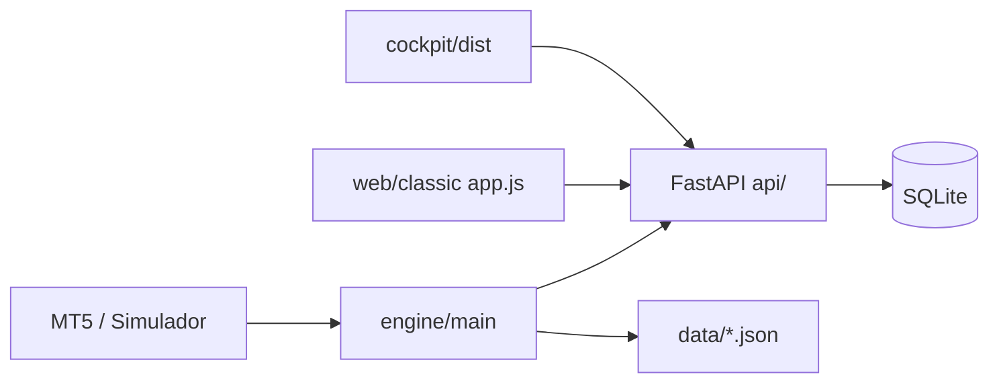

# Roadmap — visualização, dados e produto (auditoria estratégica)

**Repositório:** `sala-sinais`  
**Data:** outubro/2026  
**Objetivo do usuário:** day trade B3 (WIN + ações), simulação → paper MT5 → live, PnL com taxas, biblioteca de conhecimento, UI orbital (cockpit) como cara do produto.

Este documento consolida o estado real do código (`engine/`, `api/`, `cockpit/`, `web/` classic, `shared/`, `library/`, `docs/`, `tests/`) e prioriza o que melhora **decisão** e **confiança** antes de escalar risco.

---

## 1. Estado atual (resumo honesto)

### O que funciona bem

| Área | Evidência |
|------|-----------|
| **Pipeline sim → API → painel** | Engine (`engine/main.py`) em `simulation`, `paper_mt5` e `live_mt5`; heartbeat e estado em `GET /system/state`; sinais em SQLite via FastAPI. |
| **PnL com taxas** | `api/pnl.py`: WIN (R$ 0,20/ponto/contrato), ações com emolumentos %; IR estimado em `pnl_tax_breakdown`; testes em `tests/test_agent_presets_pnl_news.py`. |
| **Métricas ricas na API** | `GET /metrics/pnl`, `/metrics/trades`, `/metrics/equity-curve`, `/market/ohlc`, `/alerts/recent`, `/stats` — backend à frente do cockpit. |
| **Painel classic (`/classic`)** | `web/app.js` + Chart.js Financial: candlestick multi-TF, curva PnL, patrimônio + **drawdown %**, vitórias/derrotas, busca de tickers B3, biblioteca com filtros, alertas, checklist modo real. Poll ~5s health / ~20s dados. |
| **Execução MT5** | `engine/execution.py` (ordens SL/TP), `engine/mt5_close.py` (sync fechamento via deals), política em `shared/execution_policy.py`, preflight `engine/scripts/preflight_live.py`. |
| **Agente** | Presets conservador/moderado/agressivo, `strategy_type` breakout/volatility, capital e risco %, multi-símbolo via `/agent/config`. |
| **Notícias + filtro** | RSS em `GET /news/headlines`; engine `news_context.py` bloqueia entradas em viés cauteloso (heurística PT). |
| **Biblioteca** | 8 artigos curados em `library/`, export/import ZIP, stats API; backup automático em `library/backup/`. |
| **Cockpit orbital** | UX diferenciada (`cockpit/`), sol PnL do dia, controles pause/resume/flatten, zonas modulares, build Vite. |
| **Testes** | 8 módulos pytest cobrindo DB, PnL, equity, trades, library, execution policy, IDs do painel. |

### O que é fraco ou incompleto

| Problema | Impacto |
|----------|---------|
| **Paridade cockpit ≪ classic** | Raiz `/` serve orbital; **sem gráficos**, sem equity/drawdown, sem alertas, sem busca de tickers, KPIs de trades até recentemente só mês/all-time. Classic concentra ~2700 linhas de `app.js`. |
| **PnL de fechados depende de `exit_price`** | ROADMAP já admite: sem histórico MT5 completo, trades abertos/fechados fora do fluxo do sinal ficam cegos. `mt5_close` ajuda em live, mas não cobre reentrada manual no terminal. |
| **OHLC / volume** | `GET /market/ohlc` agrega M1 do engine ou `quote_history` — **sem volume real** de book; candlestick é educacional, não profundo. |
| **Sem heatmap / correlação / exposição agregada** | API não expõe posição consolidada multi-ativo nem métricas por hora/dia da semana. |
| **Stale vs real-time** | Cotação: `data/last_quote.json` (poll do engine). Classic não mostra idade da cotação de forma proeminente; cockpit mostra linha simples. News cache ~600s. |
| **Segurança operacional** | Painel sem auth; adequado só localhost/VPN. |
| **Backtest / paper vs live compare** | Não há snapshot de simulação lado a lado com live. |
| **Journal estruturado** | `entry_reason` / `exit_reason` existem no modelo, mas UI não monta funil signal→fill→close nem tags de erro de execução. |
| **WIN day trade** | Estratégias são breakout/volatility em M1; horário B3 e risco existem no engine, mas UI não visualiza “sessão B3” vs performance. |

**Veredito:** backend e painel **classic** já sustentam um MVP sério de treino; o **cockpit** é shell premium que ainda não consome a maior parte dos endpoints. O salto para dinheiro real exige **fechamento confiável**, **visibilidade de risco** e **paridade visual** (ou link claro entre orbital e classic).

---

## 2. Visualização e dados (prioridade alta)

Ideias com valor direto para o trader — ordenadas por impacto na decisão diária.

### 2.1 Dashboard KPIs (faltando ou subutilizados)

| KPI | Fonte hoje | Onde mostrar |
|-----|------------|--------------|
| **Exposição** (contratos / R$ em risco aberto) | Calcular de sinais `open` + stop distance | Cockpit sol + faixa classic |
| **Win rate rolling** (7d / 30d) | Novo agregado em API ou client-side em `/metrics/trades` | Zona trades |
| **Drawdown atual / máximo** | Já em `EquityCurveSummary` | Cockpit mini-card + classic já tem chart |
| **Profit factor, avg win/loss** | Derivável de `TradesGlobalSummary` | Zona trades |
| **Heatmap PnL por hora** (BR) | Novo endpoint: bucket `closed_at` hora | Classic chart ou canvas orbital |
| **Heatmap dia da semana** | Idem | Idem |
| **Por ativo** | `by_symbol` em `/metrics/trades/summary` | Tabela + barras |
| **Correlação tickers** | Requer histórico de retornos — **novo** (quote_history ou barras) | P2 |
| **Taxas + líquido após IR** | Já em `/metrics/pnl` | Cockpit (parcialmente implementado) |
| **Idade da cotação** | `MarketQuote.timestamp` | Chip “dados há Xs” |

### 2.2 Gráficos

| Melhoria | Esforço | Notas |
|----------|---------|-------|
| **Volume** nas barras OHLC | M | MT5 `copy_rates` já traz volume no engine; propagar no JSON OHLC. |
| **Marcadores entrada/saída** no candlestick | M | Overlay Chart.js a partir de `signals` + `alerts/recent`. |
| **Multi-TF sync** (M1/M5/H1) | S–M | Classic já troca TF; falta cursor/link entre painéis. |
| **Equity intraday** (não só diário) | M | Equity curve hoje agrega por **dia**; intraday = novo agregador por trade. |
| **PnL aberto MTM** vs fechado | S | Dados já em `open_positions_estimated_pnl`. |

### 2.3 Trade journal e funil

| Vista | Dados |
|-------|-------|
| **Linha do tempo** por trade | `TradeMetricsItem`: entry/exit, reasons, strategy_type, fees |
| **Funil** | `stats.by_status` + `execution_message` → contagem gerado / enviado / aberto / fechado / erro |
| **Filtros** | symbol, today_only, win/loss — query params já existem em parte |

### 2.4 Indicadores real-time vs stale

| Sinal | Comportamento desejado |
|-------|------------------------|
| Engine offline | Classic/cockpit já degradam; reforçar cor no sol PnL MTM |
| Quote > 30s | Badge amarelo |
| News cached | Mostrar `cached: true` do feed |
| Heartbeat | `last_heartbeat` vs `poll_interval` — tile “engine atrasado” |

---

## 3. Funcionalidades novas (roadmap P0 / P1 / P2)

Legenda esforço: **S** &lt; 1 dia, **M** 2–5 dias, **L** &gt; 1 semana.

### P0 — antes de confiar em live com UI

| Item | Esforço | Descrição |
|------|---------|-----------|
| **Paridade cockpit: KPIs + link classic** | S | Expandir zona trades (win rate, taxas, W/L); link gráficos. *Em progresso no código.* |
| **Sync fechamento MT5 robusto** | M | Deal history + reconciliação diária; fechar sinais órfãos. |
| **Export trades CSV** | S | `GET /metrics/trades?limit=500` → endpoint `text/csv` ou botão no painel. |
| **Badge idade cotação + heartbeat** | S | API já tem campos; só UI. |
| **Kill switch perda diária (R$)** | M | Engine + `system/state` + tile vermelho. |

### P1 — produto day trade B3

| Item | Esforço | Descrição |
|------|---------|-----------|
| **Alertas in-app** | M | Consumir `/alerts/recent` no cockpit; toast + som opcional. |
| **Calendário macro** | M | Feriados B3 + eventos (Copom); pode começar estático em `library/`. |
| **Position sizing wizard** | M | Capital × risco % × stop → contratos/lotes; espelha `risk.py`. |
| **Watchlist / scanner** | L | Lista de símbolos com último sinal e volatilidade. |
| **Paper vs live comparison** | M | Tag `operating_mode` nos trades + filtro UI. |
| **Backtest snapshot** | L | CSV/MT5 histórico + mesma estratégia; relatório PDF simples. |
| **Gráficos no orbital** | M | Embedar mini sparkline equity ou iframe `/classic#zone-charts`. |

### P2 — diferenciação

| Item | Esforço | Descrição |
|------|---------|-----------|
| **Heatmap hora/dia** | M | Novo `GET /metrics/performance-calendar`. |
| **Correlação tickers** | L | Matriz a partir de barras M1. |
| **Auth + token painel** | M | Para VPS exposta. |
| **WebSocket** | L | Push quote/sinais em vez de poll. |
| **RAG na biblioteca** | L | Ver seção 4. |

---

## 4. Agente e conhecimento

### Hoje

- **Biblioteca:** artigos markdown (`01` day trade … `08` fontes abertas) servidos por `api/library.py`.
- **Engine:** `news_context` referencia artigos `04` (risco) e `07` (estratégias) nos logs/`entry_reason` quando filtro dispara.
- **UI classic:** cards, categorias, leitura inline; cockpit: lista + dialog texto puro (sem markdown renderizado).

### Como a biblioteca pode influenciar a UI (sem RAG)

| Ideia | Implementação |
|-------|----------------|
| **Tooltips contextuais** | Mapear `strategy_type` → artigo `07`; risco % → artigo `04`; WIN → `02`. |
| **Cards no sinal** | Ao listar sinal com `entry_reason` contendo “notícia”, mostrar link `library/articles/04`. |
| **Checklist modo real** | Itens do checklist linkados a `06-rlp-taxas`, `MODO_REAL.md`. |
| **Preset explicado** | Ao aplicar preset, painel lateral com trecho do artigo relevante. |

### RAG (fase posterior)

1. Chunk dos 8 artigos + docs `MODO_REAL`, `EXECUCAO_AUTOMATICA`.
2. Embedding local (ex. sentence-transformers) ou API.
3. Endpoint `POST /library/ask` com citações obrigatórias — **nunca** recomendação de trade.
4. UI: chat lateral no cockpit, desligado por default.

---

## 5. Confiabilidade e modo real

### Já existe

- `preflight_live`, `assert_engine_may_start_live`, `LIVE_TRADING` guard.
- `GET /system/execution-status` — label legível de por que ordens não saem.
- Emergency flatten + pause.
- Política demo vs live em `should_execute_orders`.

### Endurecer antes de dinheiro real

| Controle | Ação |
|----------|------|
| **Preflight na UI** | Botão “Rodar checklist” chama script ou espelha checks via API. |
| **Estado execução sempre visível** | Cockpit status já chama `execution-status`; destacar em vermelho se bloqueado. |
| **Reconciliação MT5 ↔ SQLite** | Job horário: posições abertas no terminal vs sinais `open`. |
| **Auditoria** | Log estruturado de cada ordem (ticket, retcode) persistido na API. |
| **Fail-safe** | Perda diária, max trades/dia, bloqueio fora horário B3 (engine já tem hooks; expor na UI). |
| **Deploy** | VPS + MT5 + watchdog; documentado no ROADMAP genérico, não automatizado. |

---

## 6. Quick wins (&lt; 1 dia cada)

| # | Entrega | Endpoint / backend | Zona UI |
|---|---------|-------------------|---------|
| 1 | KPIs trades no orbital | `GET /metrics/pnl` (sem mudança) | Cockpit → nó **Métricas de trades** |
| 2 | Export CSV trades | Novo `GET /metrics/trades/export.csv` ou client download JSON | Classic zona trades + cockpit |
| 3 | Idade da cotação | `GET /market/quote` → campo `age_sec` calculado | Chip no header cockpit/classic |
| 4 | Alertas recentes no cockpit | `GET /alerts/recent` | Novo nó orbital ou subseção Sinais |
| 5 | Markdown na biblioteca cockpit | `GET /library/articles/{id}` | Render leve (marked) no dialog |

---

## 7. Quick win implementado nesta auditoria

**Escopo:** enriquecer a zona **Métricas de trades** do cockpit com KPIs já retornados por `GET /metrics/pnl` (win rate hoje, fechados hoje, vitórias/derrotas, taxas, IR estimado) e link para gráficos no painel classic.

**Arquivos:** `cockpit/src/orbit/panels.ts`, `cockpit/src/api/client.ts` — após editar, rodar `npm run build` em `cockpit/`.

---

## Mapa de arquitetura (dados → UI)

---

## Referências internas

- [ROADMAP.md](./ROADMAP.md) — limitações PnL e modo real  
- [COCKPIT.md](./COCKPIT.md) — build orbital  
- [PAINEL_VISUAL.md](./PAINEL_VISUAL.md) — Aurora v3 classic  
- [AGENTE_CONHECIMENTO.md](./AGENTE_CONHECIMENTO.md) — notícias + biblioteca  
- [EXECUCAO_AUTOMATICA.md](./EXECUCAO_AUTOMATICA.md) — MT5 demo  
- [MODO_REAL.md](./MODO_REAL.md) — live  

---

## Próximo passo sugerido (sequência)

1. Build cockpit + validar KPIs na zona trades.  
2. Escolher 2 itens P0 (CSV + idade cotação).  
3. Decidir se orbital ganha gráficos nativos ou “classic embarcado” no curto prazo.  
4. Demo MT5 vários dias com reconciliação de fechados antes de `LIVE_TRADING=true`.
