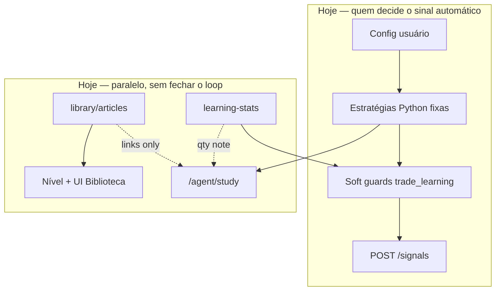

# Visão: biblioteca como memória do agente

Este documento alinha a **intenção do produto** (biblioteca pensada para o agente aprender e aplicar em compra/venda, evoluindo como um operador) com o **que o código faz hoje** e um **roteiro honesto** para aproximar visão e realidade.

Documentos relacionados: [AGENT_KNOWLEDGE.md](./AGENT_KNOWLEDGE.md), [BIBLIOTECA.md](./BIBLIOTECA.md), [TRADE_LEARNING.md](./TRADE_LEARNING.md).

---

## Validando a visão

Faz sentido tratar a biblioteca como **corpus de competência** — não só leitura humana no painel, mas material que um agente consulta, internaliza e usa ao decidir **quando** entrar, **com que tamanho** e **em que contexto** (B3, day trade, gestão de risco). A meta de “profissionalizar como uma pessoa”, reduzindo perdas e melhorando resultados ao longo do tempo, é **legítima como direção de produto**.

O sistema atual já separa bem **detecção numérica** (estratégias fixas), **pedagogia** (artigos) e **feedback estatístico** (trades fechados). O que ainda **não** existe é a ponte automática: **artigo → contexto na decisão de sinal** e **loop fechado** que ajuste parâmetros ou pesos com base na biblioteca + histórico. Essa ponte é o foco das fases 2a–2c abaixo.

---

## Estado atual (honesto)

### Biblioteca (`library/`)

| Aspecto | Realidade |
|---------|-----------|
| Conteúdo | Markdown curado + `index.json`; playbooks linkam `library_article_ids` no estudo ao vivo |
| “Nível do agente” | **Duas trilhas:** (1) artigos que **você** abriu no cockpit (`read_ids` / `library_read_progress.json`); (2) artigos que o **agente** estudou sozinho (`agent_library_progress.json`, ver estudo autônomo abaixo). Sem query na API, `knowledge-level` ainda reflete o tamanho da base (legado). |
| Efeito no motor | **Nenhum** — não altera `breakout` / `volatility`, stops ou filtros de entrada |
| Modo 24h (biblioteca) | Com `AGENT_AUTO_STUDY_LIBRARY=true`, a **API** avança artigos em `library/articles` (progresso em `data/agent_library_progress.json`); sem LLM/RAG; **não para** em pregão nem em `live_mt5` |

A biblioteca hoje é **pedagogia + progresso visual** para quem opera o painel; o agente automático **não lê** os `.md` na hora do sinal.

### Engine e estudo (`engine/`, `GET /agent/study`)

| Aspecto | Realidade |
|---------|-----------|
| Decisão de trade | Regras fixas em `engine/strategy.py` e `engine/strategy_volatility.py` + config do usuário |
| Estudo ao vivo | Replica a mesma lógica (`api/agent_study.py`): níveis, regime, playbook (`shared/daytrade_rules.py`), candles, estrutura de mercado |
| Biblioteca no estudo | Links para artigos no playbook; **não** retrieval semântico nem prompt com trechos dos artigos |

O agente **não inventa** stops: copia percentuais/pontos da config, como documentado em [AGENT_KNOWLEDGE.md](./AGENT_KNOWLEDGE.md).

### Aprendizado com trades (Fase 1)

| Aspecto | Realidade |
|---------|-----------|
| Fonte | Trades **fechados** no SQLite (`shared/trade_learning.py`) |
| Saída | Win rate, expectativa, melhor/pior estratégia, faixas horárias, frases PT em `data/trade_learning.json` |
| Diário do agente (v2) | `data/agent_journal/` — a cada **fechamento** (ganho ou perda): histórico rolling (30), «último erro» visível, «último acerto», ligação com stats operacionais; arquivo **promovido** («salvo desde primeiro acerto») na primeira vitória sem apagar perdas anteriores |
| Efeito no motor | **Soft guards** em `engine/trade_feedback.py` se `AUTO_LEARN_FROM_TRADES=true`: cooldown ampliado, filtro de sinais fracos, redução de qty nos automáticos |
| Artigos | **Não** entram no cálculo — só estatística das suas operações |

Isso **protege** após sequência ruim; **não** ensina conteúdo da biblioteca nem substitui estratégia.

---

## Lacunas: visão × realidade

| Visão (produto) | Hoje | Lacuna |
|-----------------|------|--------|
| Agente aprende com artigos e aplica na operação | Artigos só na UI e links no estudo | Sem RAG/LLM no caminho do sinal |
| Evolução de “nível” reflete competência operacional | Nível = artigos lidos + palavras | Métrica de **leitura humana**, não desempenho nem uso pelo motor |
| Menos perdas com o tempo | Cooldown/filtro/qty após WR baixo ou perdas | Reação **conservadora**, não otimização de edge |
| Decisão contextual (leilão, range, psicologia) | Regras hardcoded + artigos explicam “por quê” offline | Contexto textual **não** entra na avaliação automática |
| Feedback fecha o ciclo biblioteca ↔ trades | Trades → guards; biblioteca isolada | Sem pesos, presets dinâmicos ou memória episódica ligada a artigos |

---

## Roteiro por fases (direção, sem prazo garantido)

### Fase 2a-minimum — estudo autônomo (implementado)

- Progresso server-side em `data/agent_library_progress.json` (`read_article_ids`, `last_studied_at`, `study_log[]` opcional).
- Worker: loop **único na API** enquanto `AGENT_AUTO_STUDY_LIBRARY=true` (24h, independente de pregão B3, `ENGINE_MODE` live/paper/sim e de `OVERNIGHT_LEARNING`).
- Cada tick: próximo artigo do `library/index.json`, leitura do `.md`, contagem de palavras, digest de 1 linha (primeiro `#` do Markdown) — **sem** LLM.
- API: `GET /library/agent-study-status`, `POST /library/agent-study/tick?force=true` (dev), `GET /library/knowledge-level?agent=true`.
- Cockpit: linha **Agente** no Raio-X / balão Conhecimento; badge **Estudado pelo agente** na aba Biblioteca.
- Livros em `library/books/` — **futuro**; hoje só artigos.

### Fase 2a — RAG no caminho sinal/estudo (próximo)

- Embeddings (ou busca híbrida) sobre `library/articles` + trechos de playbook.
- No `GET /agent/study` e/ou pré-sinal: recuperar **K artigos/trechos** relevantes a símbolo, regime, padrão de candle, fase da sessão B3.
- Entrega inicial: bloco `library_context` na API e logs auditáveis — ainda **sem** mudar ordem automática, só transparência e base para 2b.

### Fase 2b — Portão LLM (playbook + artigos + learning-stats)

- Camada opcional (feature flag): modelo recebe snapshot numérico do estudo + trechos RAG + resumo de `performance_learning`.
- Saída estruturada: `allow` / `defer` / `reduce_size` + motivo PT — **gate** antes ou depois das estratégias fixas, nunca substituindo limites de risco da config sem confirmação explícita.
- Boleta manual continua fora do bloqueio, como hoje.

### Fase 2c — Loop de feedback com pesos

- Associar outcomes (win/loss, strategy_type, bucket horário) a **features** recuperadas (tags de artigo, setup).
- Ajustes graduais: preferência de estratégia sugerida, pesos em heurísticas já existentes (`is_weak_signal`), presets — sempre com teto de risco e telemetria.
- **Expectativa realista:** mercado tem ruído; objetivo é **processo** melhor e drawdowns menores, **não** lucro garantido nem “zero perdas”.

---

## O que você pode fazer agora (aproximar a visão)

1. **`AUTO_LEARN_FROM_TRADES=true`** (padrão) — deixa o motor usar soft guards após histórico suficiente; ver [TRADE_LEARNING.md](./TRADE_LEARNING.md).
2. **Fechar trades** (simulação ou demo) — sem fechamentos, win rate rolling e insights ficam vazios; guards não ativam.
3. **Presets e config do agente** — `strategy_type`, risco, stops alinhados ao que os artigos 14–18 descrevem; compare **Melhor/Pior** em `GET /agent/learning-stats`.
4. **Simulação educativa** — acumular barras M1, usar modo paper/demo, revisar **Estudo do agente** e playbook antes de LIVE.
5. **Curadoria da biblioteca** — artigos novos + export/import ZIP; isso **prepara** o corpus para 2a mesmo antes do RAG existir.
6. **Modo aprendizado 24h** (`overnight_learning` + opção 7) — refresca estudo ao vivo, `trade_learning.json` e sinais sim; a **biblioteca do agente** avança sempre que a API roda com `AGENT_AUTO_STUDY_LIBRARY=true` (também na opção 1 live/paper).

Ler artigos no painel **sobe o nível na UI** e ajuda **você** (e futuramente o RAG) — hoje **não** muda sozinho o comportamento do engine.

---

## Aviso ético e regulatório

Operação na B3 envolve **risco de perda total do capital** alocado. Este software é **ferramenta educativa e de simulação**; métricas passadas não garantem resultados futuros. Nada aqui constitui **recomendação de investimento** ou promessa de lucro. Decisões em conta real são responsabilidade do operador; use limites de risco, entenda custos e regulamentação (CVM/B3).

---

## Referência rápida de código

| Peça | Caminho |
|------|---------|
| Estudo ao vivo | `api/agent_study.py` |
| Guards no motor | `engine/trade_feedback.py` |
| Agregados e insights | `shared/trade_learning.py`, `api/trade_learning.py` |
| Nível biblioteca (UI) | `api/library_knowledge.py`, `api/agent_library_study.py` |
| Diário markdown | `api/agent_journal.py`, `data/agent_journal/journal_meta.json` |
| Playbook + IDs de artigo | `shared/daytrade_rules.py` |
